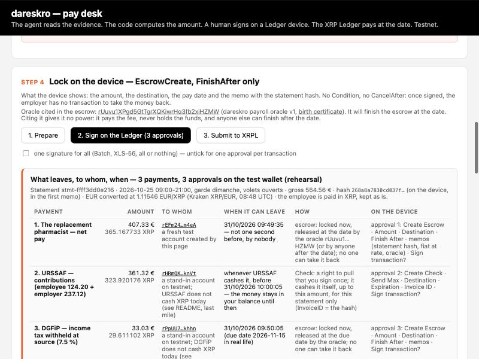
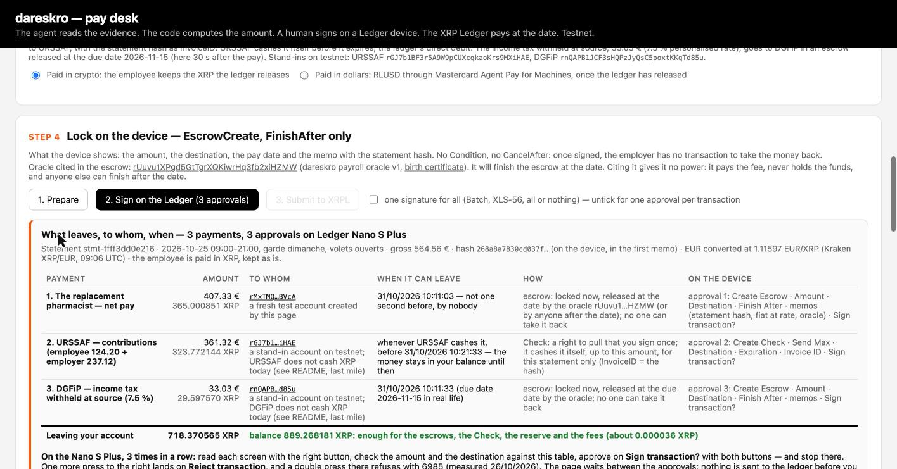
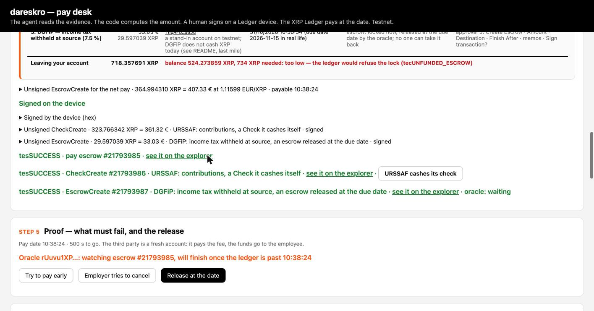

# `paie/` — the Sunday shift, paid for real

The New York demo paid a fictional Sunday shift in dollars, on testnet, to a fresh account. This module
takes the same case one step towards a real replacement pharmacist paid by a real pharmacy, with the
minimum French payroll law asks for, and says plainly what is still missing. Everything below was
measured on 31/10/2026; every hash is on the XRPL testnet.

| Deliverable | Where | Status |
|---|---|---|
| The statement in euros, the currency it was computed in | `en_euros.py` → `sortie/bulletin_eur.json` (sha256 `268a8a78…`) | done, equivalence measured |
| The official payslip (French mandatory mentions), deterministic PDF, same SHA-256 on it as in the escrow memo | `bulletin_officiel.py` → `sortie/bulletin_officiel.pdf` | done, byte-identical across runs |
| The desk's real mode: one approval per transaction when a Ledger device signs, a "what leaves, to whom, when" screen, the test wallet kept for rehearsals | `app/src/PaieReelle.tsx`, localized changes in `app/src/App.tsx` and `app/src/xrpl.ts` | done, rehearsed twice on testnet — the first rehearsal caught a real bug (below) |
| The last mile to bank accounts: a SEPA credit transfer order (ISO 20022 pain.001) from the statement, written, **not executed** | `ordre_sepa.py` → `sortie/ordre_virement.pain001.xml` | done |
| Anchoring the statement's SHA-256 (never the document) on the ledger: testnet measured, mainnet prepared and **not executed** | `ancrer.mjs` → `sortie/ancrages.json` | testnet done; mainnet waits for Julien's decision |
| The real run on the Nano S Plus, three approvals, hashes and captures | section 5 | **done, 31/10 09:29 UTC**: the first attempt expired (`tefMAX_LEDGER`, nothing applied), the second went through |
| The sealed payslip as an NFT in the employee's wallet, readable by the named administrations only | `sceller.mjs` → `sortie/bulletin_scelle.json`, `sortie/nft.json` | done, measured on testnet (section 6) |

## The statement in euros

`agent/bulletin_garde.py` computes every line from euro parameters (point value 5.277 €, hourly rate
20.8756 €, IDCC 1996) and labelled the result `"currency": "USD"` for the dollar leg of the demo. A
French payslip, a SEPA order and a real pay are in euros, so `en_euros.py` writes the same statement with
`currency = "EUR"` and nothing else changed, recomputes the SHA-256 with the exact rule of
`bulletin_garde.py`, and records where it comes from (`sortie/bulletin_eur.provenance.json`).

Measured: `agent/bulletin_garde.py --devise EUR` run on the same evidence (in a scratch copy, with the
engine) gives the same six lines, the same gross 564.56, net 440.36, tax 33.03, net paid 407.33, URSSAF
361.32, cost 801.68; the only keys that differ are `computed_at` and therefore `sha256`.

| | currency | SHA-256 |
|---|---|---|
| `agent/sortie/bulletin.json` (the demo, unchanged, input of every run before 31/10) | USD | `384ec59ca17114dbe09e081c5cf0990a4cbe5ba859519ca2a8c1ca9a2f8347bf` |
| `paie/sortie/bulletin_eur.json` = `app/public/bulletin_eur.json` (the real shift) | EUR | `268a8a7830cd037fa013ce497266debebf50e4c421248bf8fec6c0a56db5b94b` |

The desk serves both: a "Statement file" selector on card 1, or `?bulletin=bulletin_eur.json` in the URL.

## 1. The official payslip — `bulletin_officiel.py`

```bash
.venv/bin/python -m pip install reportlab          # once
.venv/bin/python paie/en_euros.py                  # the statement in euros
.venv/bin/python paie/bulletin_officiel.py          # -> paie/sortie/bulletin_officiel.pdf (+ .sha256, .temoin.json)
.venv/bin/python paie/bulletin_officiel.py --bureau # also copies the PDF to ~/Desktop
```

**One source.** The PDF is laid out from the statement JSON — the file whose SHA-256 the pay escrow
carries in its first memo — and prints that SHA-256 in its "Preuve" block. It never recomputes the pay;
it re-checks it and refuses to print if anything disagrees: the file's `sha256` against its canonical
form; each remuneration line against base × rate (hours × hourly rate, hours × 1.5 point, 15 % seniority
on the prorated minimum, 10 % end-of-contract bonus on the shift gross, 10 % paid-leave allowance on gross
+ bonus); gross = sum of the lines; net = gross − employee contributions; paid = net − tax; cost = gross +
employer contributions.

**Deterministic.** reportlab's invariant mode (fixed creation date, fixed document ID): the same JSON and
the same employer file give a byte-identical PDF. Measured: two runs, one hash,
`ec75f4ce516c5793514dbff371f1fab4fcba76d6a27a94826dd441808f2cbceb` for the example PDF (2 pages A4).
The hash sits next to the PDF (`.pdf.sha256`) and in `bulletin_officiel.temoin.json`.

**What is on it** (C. trav. R3243-1, simplified model of the arrêté of 25/02/2016 as amended, montant
net social since 2023): employer (name, address, SIRET, APE, URSSAF), collective agreement IDCC 1996,
employee (name, address, job, classification, entry and exit dates, CDD reason), period and hours (12 h
retained from the schedule and the badge, 8 h at +25 % and 4 h at +50 % after the 35 h already worked, 12
h of compensatory rest outside the sheet), the six lines with base and rate, gross, the contributions in
the legal rubrics (health, work accidents, pension, family, unemployment, employer-only contributions,
agreement-based, CSG deductible, CSG/CRDS non-deductible), net before tax, montant net social, taxable
net, income tax at source (base, personalised rate, amount, remitted to DGFiP on the due date), **net paid
in euros**, total employer cost, employer relief, paid leave (one-day contract: the allowance is paid,
balance 0), payment date and masked IBAN, and the two legal notices (keep without time limit;
service-public.fr for the terms).

**Said on the sheet itself, in red:** the contribution rates are **aggregated indicative rates** (22 %
employee, 42 % employer, bought with the rules on 25/10) until real rates are entered; the example
employer file is **example data**. The real file is `paie/employeur.json` (gitignored: it holds
addresses, a social security number, IBANs); copy `employeur.exemple.json` and fill it in.

**What is missing for the sheet to be opposable** — not hidden, listed:

- **real rates, rubric by rubric**: the sheet prints the legal rubrics but only knows the aggregated
  totals; a payroll engine (or the URSSAF scale entered by hand in the rules service, upstream of the
  hash) must give each line, the social security ceiling split, the Agirc-Arrco bands, the CSG base at
  98.25 %, the general relief — then `taux_reels_saisis: true` removes the banner;
- **the DSN**: in France the payslip is the human face of the Déclaration sociale nominative; the
  contributions and the withholding tax are declared there and collected from it. No DSN is produced
  here, and this repository will not produce one: that is a certified payroll software's job (or an
  accountant's), and the `.temoin.json` and the escrow memos are what you hand them;
- **a payslip is not a contract**: the one-day CDD must be written and signed within two days, with its
  reason and the person replaced (C. trav. L1242-12, L1242-13);
- **the point value 5.277 € is still marked "to confirm"** in the sources, as it was in New York;
- the **montant net social** and the **taxable net** are estimated from the net before tax; the exact
  bases need the rubric detail.

What a real replacement pharmacist's shift also needs, outside this module (to check with the
pharmacy's accountant and the Ordre): the DPAE to URSSAF before the shift starts, the pharmacist's
registration at the Ordre (section D) and the replacement declared as the Code de la santé publique asks,
the entry in the single staff register, the occupational health affiliation, and the DSN of the month.

## 2. The desk's real mode

Three localized changes in `app/src/App.tsx`, one line in `app/src/xrpl.ts`, one new file
`app/src/PaieReelle.tsx`, a few CSS lines:

- **one approval per transaction by default when a Ledger device is the signer** (USB or Bluetooth);
  the Batch stays a switch, and stays the default for the test wallet and the emulator. Reason: the XRP
  app 2.8.2 refuses a Batch by itself (`6985`, blind signing off), see `LEDGER_FEEDBACK.md`;
- **the "what leaves, to whom, when" screen** between Prepare and Sign, built from the very transactions
  about to be signed: one row per payment (the replacement pharmacist's net pay, URSSAF's contributions,
  DGFiP's income tax), the amount in euros and in XRP at the rate of the moment, the destination account
  and what it is, the date the money can leave, how (escrow released by the oracle, Check cashed by the
  payee), what the device will show for that approval; then the total leaving the account against the
  balance, and the button-by-button instructions for the Nano S Plus, including the one press too many
  that gives `6985`;
- **the statement file selector** (`bulletin.json` / `bulletin_eur.json`), the rate fetched in the
  statement's currency once it is loaded (it was fetched in USD before the file was read);
- **the balance check counts the tax escrow** (it counted the pay and the contributions only; the
  `taxXrp` it needed was computed and unused — the linter had been saying so);
- **the node is configurable**: `VITE_XRPL_URL` in `app/.env.local`, default `wss://testnet.xrpl-labs.com`.



### Rehearsed on testnet, test wallet, one approval per transaction, 31/10/2026

**The first rehearsal caught a bug.** The desk locked **440.36 € (the net before tax)** in the
employee's escrow, while its own table and the oracle's registry said 407.33 € (the net paid): since
commit 754da01 of 25/10 the desk displayed the net paid but `prepare()` still took `net_to_pay`, so the
employee would have received the income tax that the DGFiP escrow also pays. The terminal script
(`oracle/demo_confidentialite.mjs`) had it right, which is why the measured 25/10 script runs read 407.33.
Fixed in `prepare()` (the escrow and the fiat memo hold the net paid; the gross memo keeps gross, net and
paid apart); the first run stays here as the measurement that found it.

| Run | Leg | Transaction | Amount | Then |
|---|---|---|---|---|
| 1 (bug) | pay escrow #21958569, employer `rh3jwGjk…` → employee `rEFm24hb…` | [B315748F…](https://testnet.xrpl.org/transactions/B315748FA3962DAA249414886BD1338BE5D0A3EB4229D43A116E9F92D8455811) | **395.253653 XRP = 440.36 €** at 1.11412 (memo `paid=440.36`: wrong) | released by the oracle 08:44:01 UTC [C89CB78D…](https://testnet.xrpl.org/transactions/C89CB78D713376F0F3E464F82C2DEC9B6215947F3E3D4CA4F4DAFEDDF66B7962) |
| 1 | Check #21958570 for URSSAF, `InvoiceID` = statement hash | [35BCCC88…](https://testnet.xrpl.org/transactions/35BCCC88EC38FE960C3DD816FDCE62F32DA2319FC50B802B997740A9607D8002) | 324.309769 XRP = 361.32 € | cashed by the stand-in [258B32CB…](https://testnet.xrpl.org/transactions/258B32CBD69B7C14EF442C7AAF6FAAB971BB164DFFA8B3FE043A5443CDFBFBB4) |
| 1 | tax escrow #21958571 to DGFiP | [1A6A9DFF…](https://testnet.xrpl.org/transactions/1A6A9DFFF9D70878C593C4B97B2355A37296307766D5AECC2DCA9D033447AF25) | 29.646717 XRP = 33.03 € | released [3FB7A839…](https://testnet.xrpl.org/transactions/3FB7A83971614539E97FEACEC583AF57FDAB74FDF124CF0C00C6F577CB4D8777) |
| **2 (fixed)** | pay escrow #21958572 → `rEFm24hb…` | [AAB51E89…](https://testnet.xrpl.org/transactions/AAB51E8989DC87DCE71E75637EB67A5E4A5C3F7949D65953896312606938FDAA) | **365.167733 XRP = 407.33 €** at 1.11546 EUR/XRP (Kraken); memos: sha256 `268a8a78…`, id, `407.33 EUR @ 1.11546`, oracle, `gross=564.56;net=440.36;employee_rate=0.22;tax_rate=0.0750;paid=407.33`, zk commitment | released by the oracle 08:49:48 UTC [C5919A57…](https://testnet.xrpl.org/transactions/C5919A571E31A8C0292974C7FB0E5996D1D450789458C17444011D5DA5493E44), employee paid in XRP |
| 2 | Check #21958573 for URSSAF (`rHRmQKXH…`), `InvoiceID` = `268A8A78…`, memo `contributions=361.32;employee=124.20;employer=237.12;period=2026-10;due=2026-11-15` | [950EFC44…](https://testnet.xrpl.org/transactions/950EFC44923EC38B7B697CEA7C9DFF0F50C9A3497CC7DDA3FD6F275C625142D3) | 323.920176 XRP = 361.32 € | cashed by the stand-in [23259B6B…](https://testnet.xrpl.org/transactions/23259B6BE3C2EA8D8E6D81A0BFDFFB7C4FF68281409AC35B32F29E587A1D305E) |
| 2 | tax escrow #21958574 to DGFiP (`rPpUU7Xo…`), memo `withheld=33.03;rate=0.0750;period=2026-10;due=2026-11-15` | [C4C8D970…](https://testnet.xrpl.org/transactions/C4C8D970D3BA821E5AD4CB14E16DA85C16D78840AB63B8CD77E577E96F664D08) | 29.611102 XRP = 33.03 € | released by the oracle [ED906AD3…](https://testnet.xrpl.org/transactions/ED906AD30A2CCE565F476717B6A5121FF98E7828C7BB812493FDE07CBD5DF6D2) |

Three separate submissions, three sequences, no Batch: the shape the Nano S Plus can sign. Memos read
back from the chain with `node paie/lire_tx.mjs <hash…>`. Two things seen on the way: the testnet faucet
throttles bursts ("Failed to fetch" while creating the stand-in accounts; Prepare again after a pause),
and the Mastercard sandbox no longer answers JSON (`Dollars via Mastercard: failed … <!DOCTYPE`): the
dollar leg of the demo is over, which is one more reason the real last mile is a bank transfer.

## 3. The last mile — `ordre_sepa.py`, written and not executed

In France an employee's pay goes through a payslip and a bank transfer (C. trav. L3241-1). The ledger
locks the net paid and releases it at the date; the replacement pharmacist's bank account still has to be
credited in euros. Three roads, said as they are on 31/10/2026:

- **SEPA credit transfer from the pharmacy's account** — the road that works today. `ordre_sepa.py`
  writes the ISO 20022 `pain.001.001.03` file a bank portal or payroll software uploads: one transfer,
  service level SEPA, category and purpose `SALA`, the net paid 407.33 €, requested execution on the
  payment date, debtor = the pharmacy (IBAN, BIC, SIRET as organisation id), creditor = the employee,
  remittance `SALAIRE 2026-10 GARDE 2026-10-25 BULLETIN stmt-ffff3dd0e216 SHA256 268a8a7830cd037f`,
  `EndToEndId` = the statement id. Checks: EUR only (the USD demo statement is refused), the statement's
  hash, IBAN mod-97, BIC shape, the SEPA character set (accents transliterated), 35/140-character limits,
  control sums, the XML parses back. Deterministic (`CreDtTm` = the statement's `computed_at`): example
  file `sortie/ordre_virement.pain001.xml`, sha256
  `2c2a43146fbd823a01da7ab67fd1c0770fcab845f883461c537de4df66998f03`, `.temoin.json` next to it with
  `"executed": false`. Nothing sends it: uploading it is a human act at the bank. Banks are moving to
  `pain.001.001.09`; the fields are the same, the namespace changes.
- **RLUSD → euros**: RLUSD is a dollar; turning the XRP or RLUSD the ledger released into euros on a
  French account means an exchange or a payment institution with a SEPA leg, a KYC'd account in the
  employee's name, and a conversion at the day's rate — none of which exists in this repository, and
  the ledger escrow would then be an intermediate step, not the payment. Not built; named.
- **URSSAF and DGFiP do not cash XRP.** On the ledger the Check and the tax escrow exist and are
  measured above; in the euro world those two legs are **not transfers at all**: the contributions and
  the withholding tax are declared in the DSN, and the DSN triggers their SEPA direct debit on the
  pharmacy's account at the due date (the 15th). `ordre_sepa.py` says so in its output and in the
  `.temoin.json` (`"route": "NOT in this file: declared in the DSN…"`); with `--administrations` and
  IBANs in the employer file it writes two more transfers as a three-leg proof of concept, flagged as
  such. The Check and the escrow remain what they were in New York: the ledger's proof that the money
  was set aside the day the shift was validated.

## 4. Anchoring the fingerprint — `ancrer.mjs`

The document never goes on the chain; its SHA-256 does. An `AccountSet` with no setting changed and three
memos (`dareskro/sha256` = the statement's hash, `dareskro/pdf-sha256` = the official PDF's hash,
`dareskro/doc` = "bulletin de paie" + the opaque id); no amount moves, the account pays the network fee.
Anyone holding the PDF or the JSON hashes it and finds that value in a validated ledger, dated by its
close time; nobody reads the pay, the name or the day from the chain.

```bash
cd paie && npm install
node ancrer.mjs creer-cle --reseau testnet         # faucet-funded key -> paie/cles/ancre.testnet.json (0600, gitignored)
node ancrer.mjs ancrer   --reseau testnet          # writes the memo, records it in paie/sortie/ancrages.json
node ancrer.mjs verifier --reseau testnet --tx <HASH>
```

**Measured on testnet, 31/10/2026 08:36 UTC:** account `rBYUzLoGJcfr9xGM329hfVgGjUsGkiRjQW`,
[8427D2E4…](https://testnet.xrpl.org/transactions/8427D2E4C94EDCA694486B6E980C397328C051787C9E1B2E08BE2A7D0427A2DB)
`tesSUCCESS`, ledger 21958530, fee 12 drops; `verifier` reads it back: `dareskro/sha256` = `268a8a78…` →
MATCH, `dareskro/pdf-sha256` = `ec75f4ce…` → MATCH, `RESULT: OK`.

**Mainnet, prepared, not executed.** It runs only on Julien's explicit decision, and the script enforces
the shape of that decision:

1. `node ancrer.mjs creer-cle --reseau mainnet` generates the key **offline** into
   `paie/cles/ancre.mainnet.json` (0600) and prints the address only — or Julien writes
   `{ "seed": "s…" }` there himself; the script refuses a file readable by anyone else;
2. the account is funded with the base reserve (1 XRP) plus a few fees, about 1.2 XRP, from Julien's
   own wallet; the script reads `server_info` and refuses below reserve + fees;
3. `node ancrer.mjs ancrer --reseau mainnet --mainnet-je-confirme` — without the flag written in full the
   script prints what it would write and sends nothing. Node `wss://xrplcluster.com`, or
   `XRPL_MAINNET_URL`.

No key is in this repository, in a chat or in a log; `ancrages.json` holds hashes and addresses only.

## 5. The real run on the Nano S Plus — three approvals, 31/10/2026

Chrome, Ledger Live closed, Nano S Plus over USB, XRP app 2.8.2, the desk of this branch at
`http://localhost:5174/?bulletin=bulletin_eur.json`, the oracle running. Julien held the device and
pressed the buttons; the page was driven from the Chrome extension, which cannot press a WebHID picker:
**the "Connect the Ledger" click has to be a human one** (an extension click gets `No selected device`).
The employer is the Nano's own account `r3F1bhQGMMXeg3fVJqAGutfgt6Qi8Eu1Tp`, the one of 24/10.

**First attempt, 09:06–09:17 UTC: three signatures, then `tefMAX_LEDGER`, nothing applied.** The
three reviews, read screen by screen while the operator explained them, took longer than the 150
ledgers (about eight minutes on testnet) the desk gave every transaction as `LastLedgerSequence`. The
first submission answered `The latest ledger sequence 21959312 is greater than the transaction's
LastLedgerSequence (21959183)`, the desk stopped there, the two other legs were never sent: not a drop
moved. Fixed in `xrpl.ts` (`LEDGER_WINDOW = 600`, about half an hour), pay delay set to 900 s.

**Second attempt, 09:26–09:29 UTC: three approvals on the device, three `tesSUCCESS`.**

| Leg | Signed on the Nano S Plus | Result |
|---|---|---|
| pay escrow #21793985: **364.994310 XRP = 407.33 €** at 1.11599 EUR/XRP → the test employee `rMxTMQCJ…`; device memos `dareskro/sha256` = `268a8a78…`, `dareskro/fiat` = `407.33 EUR @ 1.11599`, `dareskro/oracle`, `dareskro/zk-commitment` | approval 1 | [D732477B…](https://testnet.xrpl.org/transactions/D732477B740BB5B8FE2166E088EAD390551F70F158C29C1D6E4DE0B3EC41EBA2) `tesSUCCESS`, ledger 21959432, 09:29:22 UTC |
| Check #21793986 for URSSAF (`rGJ7b1BF…`): 323.766342 XRP = 361.32 €, `InvoiceID` = `268A8A78…` | approval 2 | [7722EF6F…](https://testnet.xrpl.org/transactions/7722EF6F899A7451046095963101067C5C3C994211A7EF53DE0C3BBB0C15B227) `tesSUCCESS`, ledger 21959434 |
| tax escrow #21793987 for DGFiP (`rnQAPB1J…`): 29.597039 XRP = 33.03 €, FinishAfter = pay date + 30 s | approval 3 | [2B51B60A…](https://testnet.xrpl.org/transactions/2B51B60AC4D4CC5F599EFE466385058EB196D43428E35BF86B4E480EE35BAC65) `tesSUCCESS`, ledger 21959435 |
| URSSAF cashes its Check (`CheckCash`, the stand-in's own key) | — | [076D6ED3…](https://testnet.xrpl.org/transactions/076D6ED31AB2513F1AA0D5A9DC2FAEEFEE64241E372987084778B55A6BF7EDF8) `tesSUCCESS` |
| the oracle releases the pay at the date (09:38:24 UTC) | — | [956F34F6…](https://testnet.xrpl.org/transactions/956F34F69FB9832098C193F2238DA38CEAACC8E6E515FE726BB9869A40518D42) `tesSUCCESS`, 09:38:35 UTC, 11 s after the date; the employee holds 364.994310 XRP |
| the oracle releases the income tax to DGFiP 30 s later | — | [8BDE169A…](https://testnet.xrpl.org/transactions/8BDE169A906BF52F39C9C46C3A45D7B2D3FD97AFE5F1D0FFB4A03A057F804D9A) `tesSUCCESS`, 09:39:10 UTC |




Memos read back with `node paie/lire_tx.mjs`. On the device the compact form is used (no `MemoFormat`,
four memos on the pay escrow, none on the Check): the three transactions carry the same statement hash
as the official PDF and the SEPA order. Two things learned: a transaction prepared for a device needs a
validity window sized for a human reading three reviews, not for one click; and the "what leaves" table
read "too low" after the lock (the balance had, rightly, dropped) — fixed, it now says "locked on the
ledger, balance now N XRP".

## 6. The sealed payslip as an NFT — `sceller.mjs`

Asked on 31/10: can a copy of the payslip go on the chain, for the pension fund, invisible to all and
visible to the competent administrations? Yes, with two corrections to the wording, both measured:

- **the copy goes to the employee, not to the pension fund.** The law tells the employee to keep every
  payslip without time limit; the pension fund asks for it decades later, when the employer may be gone.
  So the sealed payslip is a token in the **employee's** wallet that nobody can take back (no
  `tfTransferable`: it moves between issuer and holder only, a payslip is not for sale; no
  `tfBurnable`: the issuer cannot destroy it), and each administration holds a **key** to open it, not a
  copy;
- **the payslip itself never goes on the chain, even encrypted.** A ledger is immutable and a key can
  leak in ten years; a regulator tolerates hashes on a chain, not personal data. The sealed file stays
  off-chain (with the employer, the employee, or a private store); the token carries its hash as its URI.

What `sceller.mjs` does, with the sealing scheme of the hackathon (`agent/confidentiel.mjs`: AES-256-GCM
under a fresh content key, the key wrapped per reader with X25519 + HKDF-SHA256 + AES-256-GCM):

1. `init-lecteurs`: X25519 keys for four readers — `employee`, `urssaf`, `dgfip`, `retraite`
   (Agirc-Arrco for an employed pharmacist) — stand-ins on testnet (`paie/cles/lecteurs/`, 0600,
   gitignored); public halves in `sortie/lecteurs_publics.json`;
2. `sceller`: the statement JSON and the official PDF sealed together into `sortie/bulletin_scelle.json`
   (23 210 bytes, ciphertext padded to 4 096-byte multiples, header authenticated as AAD), one envelope
   per reader;
3. `frapper`: `NFTokenMint` by the employer (taxon 1996 = the IDCC, URI
   `dareskro:scelle/sha256/<hash of the sealed file>`, memos = statement SHA-256, PDF SHA-256, sealed
   file SHA-256, readers), `NFTokenCreateOffer` for 0 XRP to the employee only, `NFTokenAcceptOffer` by
   the employee's own key;
4. `ouvrir --role R`: what that reader gets from the chain and the file.

**Measured on testnet, 31/10/2026 09:33 UTC** (`sortie/nft.json`): issuer `rBYUzLoGJcfr9xGM329hfVgGjUsGkiRjQW`,
holder `rsVJocSgCeUAMCX2Xg3yRoe6opxpBmvTuC`, NFT `0000000073982907650FF7D1C69E12D241A4778C19152D8398423CD1014F0F82`;
mint [80885B0C…](https://testnet.xrpl.org/transactions/80885B0CF6B41C47F09D17FB6257CBB5E253C3F0CC2AA57EB76FF2F73BEF77BC),
offer [910E24C4…](https://testnet.xrpl.org/transactions/910E24C4274E60280153FDB7A9F35EC634C42A4AD9AD9F0316545F55B6A81316),
accept [F74B0BEE…](https://testnet.xrpl.org/transactions/F74B0BEE8CA66C2CEBA537557C052FBC912B9E2E49598BE412C5DD6FF1F15600),
all `tesSUCCESS`. Then:

| Reader | What it gets |
|---|---|
| the public | the token, its issuer, taxon 1996, the URI, four hashes and the readers' names; the file is 16 384 bytes of ciphertext: no name, no amount, no date — `RESULT: nothing private is readable by the public` |
| `retraite` (pension fund) | opens the envelope with its key: statement `stmt-ffff3dd0e216`, gross 564.56 €, net paid 407.33 €, URSSAF 361.32, DGFiP 33.03; the statement hash recomputed = the memo, the PDF's hash = the memo (the PDF written to `sortie/ouvert/retraite/` is byte-identical to `bulletin_officiel.pdf`) — `RESULT: OK` |
| `employee` | the same, `RESULT: OK` |
| a stranger's X25519 key (`--cle`) tried as `retraite` | `retraite's key does not open this envelope` |

Said plainly: this is an archive and a proof the employee carries for life, not a declaration — the
pension fund still gets the rights through the DSN. On the device, in a real run, the mint and the offer
are two more clear-signed approvals (`NFTokenMint`, `NFTokenCreateOffer`; the employee's accept is theirs).
And no administration publishes an X25519 key today: the four readers are stand-ins.

## Run it, end to end

```bash
.venv/bin/python -m pip install reportlab
.venv/bin/python paie/en_euros.py                       # the euro statement (+ app/public/bulletin_eur.json)
.venv/bin/python paie/bulletin_officiel.py --bureau      # the official payslip PDF, on the Desktop too
.venv/bin/python paie/ordre_sepa.py                      # the SEPA order, written, not sent
cd paie && npm install && node ancrer.mjs ancrer         # anchor the hash on testnet (creer-cle first)
node sceller.mjs init-lecteurs && node sceller.mjs sceller && node sceller.mjs frapper && node sceller.mjs ouvrir --role retraite
cd ../app && npm run dev                                 # the desk: http://localhost:5173/?bulletin=bulletin_eur.json
```

`paie/employeur.json` (gitignored) replaces the example employer and employee; the outputs then go to
`paie/sortie/reel/` (gitignored too). The keys for anchoring live in `paie/cles/` (0600, gitignored).
